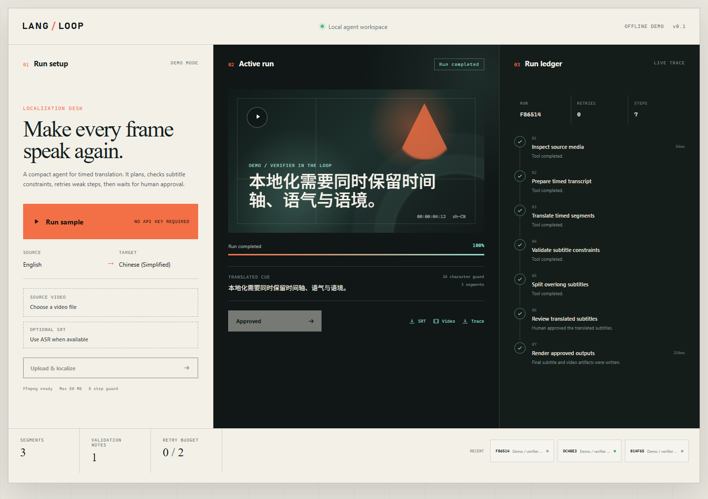

# VideoLocalize Agent

A verifier-in-the-loop subtitle localization agent for short video. It accepts a
video and optional SRT, runs a bounded tool workflow, surfaces retries and
validation results, pauses for human approval, and then renders translated
subtitles and a subtitled MP4.



## What it demonstrates

- Agent runtime with explicit tool execution, trace, retry budget, and stopping
  conditions.
- Video inspection and audio extraction through FFmpeg.
- Timed subtitle parsing, translation, constraint validation, repair, and
  rendering.
- Human-in-the-loop checkpoint before final output.
- FastAPI backend, SQLite job state, artifact download, responsive web console,
  offline demo mode, unit/API tests, and Docker deployment.

## Run locally

```bash
python -m venv .venv
.venv\Scripts\activate
pip install -r requirements.txt
uvicorn app.main:app --host 127.0.0.1 --port 8000
```

Open `http://127.0.0.1:8000`. Click **Run sample** to execute the full workflow
without an API key. The demo creates a short video, produces translated
subtitles, triggers one subtitle-length repair, pauses for review, and renders
the final artifact after approval.

Run the same workflow from the terminal:

```bash
python scripts/run_demo.py
```

## Use a live model

Copy `.env.example` to `.env` and fill in an OpenAI-compatible chat endpoint:

```text
LLM_BASE_URL=https://api.openai.com/v1
LLM_API_KEY=...
LLM_MODEL=...
```

Upload an SRT with the video for the simplest live setup. To use speech
recognition, also configure:

```text
ASR_BASE_URL=https://api.openai.com/v1
ASR_API_KEY=...
ASR_MODEL=...
```

The backend expects `/chat/completions` for translation and
`/audio/transcriptions` for ASR.

## Run with Docker

```bash
docker compose up --build
```

The application is available at `http://127.0.0.1:8000`. Job data and artifacts
are persisted in `./data`.

## Test

```bash
python -m pytest -q
```

The test suite covers SRT round-tripping, timing validation, tool retries, demo
workflow state, human approval, API creation, and recent-run queries.

## API

- `POST /api/jobs/demo`: create and run an offline demo job.
- `POST /api/jobs`: upload a video and optional SRT.
- `GET /api/jobs/{id}`: read job state and ordered agent steps.
- `POST /api/jobs/{id}/approve`: approve the translated subtitle and render.
- `GET /api/jobs/{id}/artifacts/{filename}`: download outputs and trace.
- `GET /api/config`: inspect runtime capabilities without returning credentials.

## Architecture

See [docs/architecture.md](docs/architecture.md) for component boundaries,
workflow, persistence, and failure handling.

## Limitations

- The offline demo uses deterministic translations and is visibly labeled.
- A live run needs an OpenAI-compatible provider or an uploaded subtitle file.
- The first version targets short clips and sequential jobs.
- Burn-in requires an FFmpeg build with libass; the renderer automatically falls
  back to a soft-subtitle MP4.
