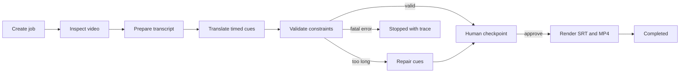

# VideoLocalize Agent Architecture

## Objective

Produce a translated subtitle and subtitled video while making agent decisions,
tool results, validation failures, and the human checkpoint visible to the user.

## Runtime Flow

## Components

### Planner and tool runtime

The demo mode follows a deterministic planner. The live mode uses the same tool
runtime and can be replaced by a model-driven planner without changing the
subtitle, storage, or media layers.

`ToolRunner` owns retry budgets and produces attempt-level trace data. A failed
tool can retry once before the job is stopped.

### Tools

- `inspect_video`: reads duration and resolution through FFmpeg.
- `prepare_transcript`: loads an uploaded SRT or calls a configured ASR endpoint.
- `translate_segments`: uses the offline demo dictionary or an
  OpenAI-compatible chat endpoint.
- `validate_subtitles`: checks duration, overlap, empty cues, and character
  limits.
- `repair_subtitles`: splits overlong translated cues while preserving timeline
  order.
- `render_outputs`: writes SRT, burns subtitles into MP4, and falls back to a
  soft-subtitle remux if libass is unavailable.

### Human checkpoint

The job stops at `awaiting_approval`. Rendering is allowed only after explicit
approval, preventing an agent-generated translation from silently becoming the
final deliverable.

### Persistence

SQLite stores jobs and ordered steps. Each completed job also writes
`agent_trace.json` and final artifacts under `data/artifacts/<job-id>/`.

## Failure handling

- Upload size and subtitle size limits.
- Maximum agent step count in the configuration.
- Tool retries with attempt-level details.
- Invalid or missing transcript stops the job with a user-visible error.
- Video rendering falls back to soft subtitles if burn-in fails.

## Demo boundary

Offline demo mode uses deterministic translations so the complete workflow can
be evaluated without external credentials. The interface labels this as
`OFFLINE DEMO`. Live model and ASR behavior require provider configuration in
`.env`.
